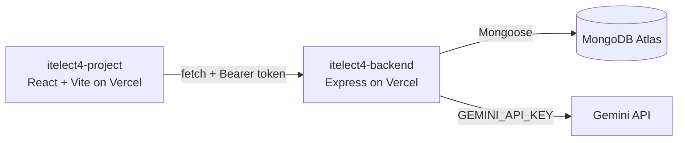

# itelect4-backend

[](https://github.com/lyruslei/itelect4-backend/actions/workflows/ci.yml)

**Campus Lost & Found Tracker**, the REST API: Express 5 in TypeScript, MongoDB Atlas through Mongoose, JWT login, and one route that asks Gemini to review an item report.

- **Live API:** https://itelect4-backend-mu.vercel.app/api/health
- **Live site:** https://itelect4-project-delta.vercel.app
- **Frontend repo:** https://github.com/lyruslei/itelect4-project

## Architecture



## Routes

| Method and path | Auth | What it does |
|---|---|---|
| `GET /api/health` | none | `{ ok, db }`; `db` is true when Atlas is connected |
| `POST /api/auth/register`, `POST /api/auth/login` | none | create an account; log in and get a JWT |
| `GET /api/claims`, `GET /api/claims/:id` | none | public claims |
| `GET/POST /api/items`, `GET/PATCH/DELETE /api/items/:id` | Bearer token | the logged-in user's own items |
| `POST /api/ai` | Bearer token | Gemini reviews an item description (5 requests a minute per account) |

## Run it locally

Needs Node 22.12 or newer (Node 24 recommended).

```bash
npm install
cp .env.example .env    # fill in MONGODB_URI, JWT_SECRET, CORS_ORIGIN, GEMINI_API_KEY (PORT defaults to 4000)
npm run dev             # http://localhost:4000
npm run seed            # optional: sample claims
```

## Tests

```bash
npm test
```

`tests/ai.test.ts` uses Supertest to send real requests to the Express app (no port, no database: `connectDB` is replaced with `vi.mock`). It checks that `POST /api/ai` answers 401 with no token or a forged one, and that a valid token reaches the request schema (400). The short prompt means Gemini is never called. It needs `JWT_SECRET` (from `.env` locally).

GitHub Actions (`.github/workflows/ci.yml`) runs `npm ci`, `npm run typecheck` and `npm test` on every push, with `JWT_SECRET` from the repo's Actions secrets.

## AI-use disclosure

- **In the app:** `POST /api/ai` sends item descriptions to Google Gemini (`@google/genai`) and checks the reply against a Zod schema before returning it.
- **In development:** I used AI coding assistants while building this project: Google Antigravity for Sessions 1–10 (GT1–GT4), and Claude Code (Anthropic) for Sessions 11–12 (the Gemini AI route and page, the tests and the CI). I reviewed and tested the changes before merging them.
